[TOC]
# Keypoint Annotation for Maize in Complex Field Scenes: A High-quality Dataset and Benchmark

This document provides the data and annotation instructions for the paper **"Keypoint Annotation for Maize in Complex Field Scenes: A High-quality Dataset and Benchmark"**. It describes how images were collected, how maize stems and leaves were annotated with keypoints and bounding boxes, how the phenotypic database is organized, and how to use the provided Python scripts to convert and visualize annotations for downstream benchmarking and model development.

## Maize Phenotypic Dataset User Guide

## 1 Labelme Overview

Labelme is an image annotation tool used to create datasets for training neural networks. It runs on Python and is typically installed inside an Anaconda environment, which can be downloaded from https://www.anaconda.com/products/distribution.


### 1.1 Requirements

- Windows
- Python3
- [PyQt5](http://www.riverbankcomputing.co.uk/software/pyqt/intro)
- pillow

### 1.2 Installation

#### 1.2.1 Create a virtual environment

Before installing Labelme, create an Anaconda virtual environment. Open Anaconda Prompt and run:

```cmd
conda create -n labelme python=3.8
# This creates a virtual environment named "labelme" with Python 3.8
```
<div align=center>

</div>

#### 1.2.2 View available virtual environments

List all virtual environments with:

```cmd
conda env list
```
<div align=center>
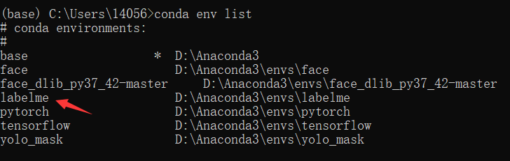
</div>


#### 1.2.3 Activate the virtual environment and install dependencies

Activate the environment:

```cmd
conda activate labelme
```
<div align=center>
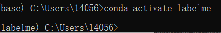
</div>

```cmd
pip install pyqt5

or

#pip install pyqt5 -i http://pypi.douban.com/simple/ --trusted-host pypi.douban.com 

pip install pillow

or

#pip install pillow -i http://pypi.douban.com/simple/ --trusted-host pypi.douban.com
```

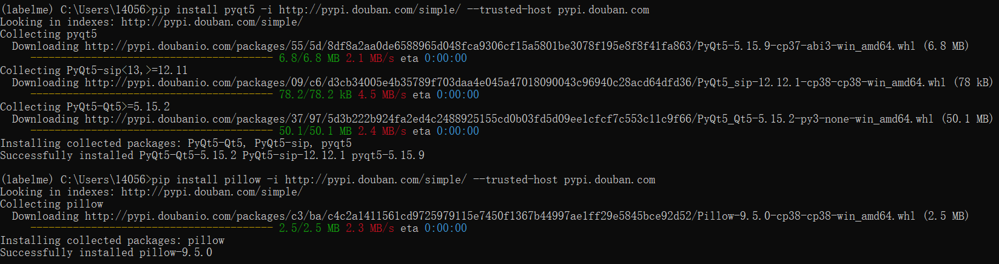

#### 1.2.4 Install Labelme

Install Labelme (version 5.3.0a0 as an example):

```cmd
pip install labelme==5.3.0a0

# Alternatively, using a Chinese mirror:
# pip install labelme==5.3.0a0 -i http://mirrors.aliyun.com/pypi/simple/ --trusted-host mirrors.aliyun.com
```

After installation, start Labelme with:

```cmd
labelme
```

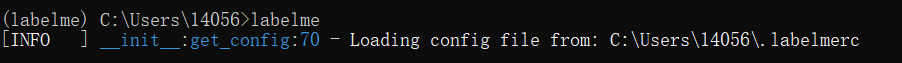

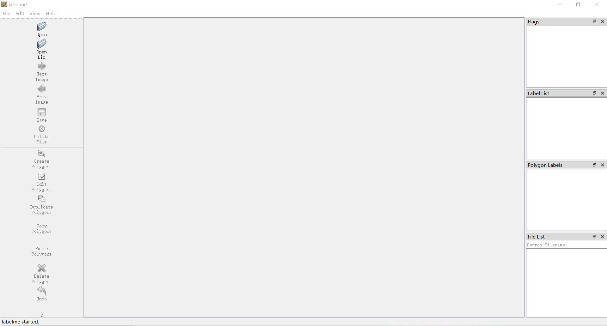

#### 1.2.5 Open labelme

For later use, open Anaconda Prompt, activate the Labelme environment, and launch Labelme:

```cmd
conda activate labelme
labelme
```

## 2 How do we collect data?

### 2.1 Image acquisition devices

This dataset uses two RGB imaging setups: a handheld DSLR camera and a camera mounted on a small drone. The drone is used to capture large-scale canopy images from above, while the handheld camera is used for near-field side views of individual plants.

#### 2.1.1 Handheld DSLR camera

The handheld camera is used to collect small-area side-view images of maize plants. The shooting frequency and angle are adjusted according to growth stage. For each plot, four plants (top, bottom, left, right) are used, and images are captured from four angles (0°, 90°, 180°, 270°), one photo per angle.

<figure align=center>
    
    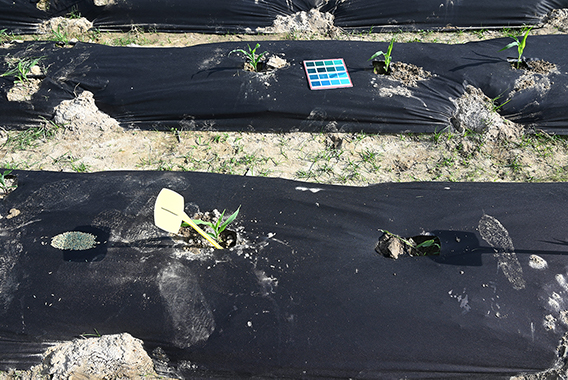
    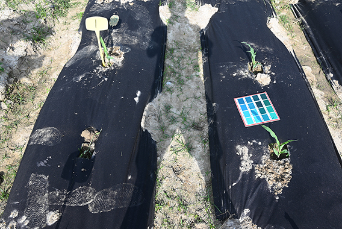
    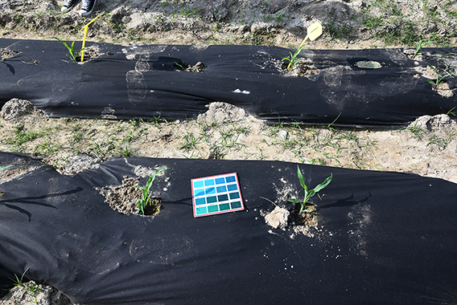
</figure>

#### 2.1.2 Small drone

Drone acquisitions are synchronized in time and frequency with the handheld camera. Two flight configurations are used: one with <10% image overlap for annotation and deep-learning datasets, and one with >60% overlap for image mosaicking. The drone camera is kept at a 90° nadir angle.

<figure align=center>
    
    
</figure>

### 2.2 Plant ID calibration and leaf labeling

#### 2.2.1 Maize plant ID calibration

Plants in each image are organized into a 2×2 grid based on the orientation of a numbered plate in the lower-left corner. This angle is mapped to the physical positions of plants, and the remaining three viewing angles are defined by 90°, 180°, and 270° rotations.

By annotating only the numbered plates at each angle, we can automatically infer IDs for plants without visible plates. After verifying all IDs, a plant-ID file is exported.

<figure align=center>
    
    
</figure>

#### 2.2.2 Corn leaf labeling

Labelme is used to annotate both stems and leaves. To balance efficiency and information content, we annotate leaf veins and stems using line segments.


### 2.3 How we label images

#### 2.3.1 Step 1 – Open the image
Open the image in Labelme.

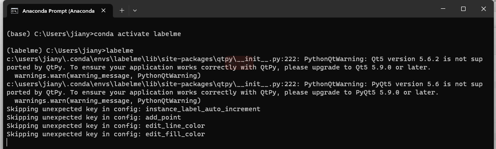

#### 2.3.2 Step 2 – Choose Create LineStrip
From the menu, select Edit → Create LineStrip.

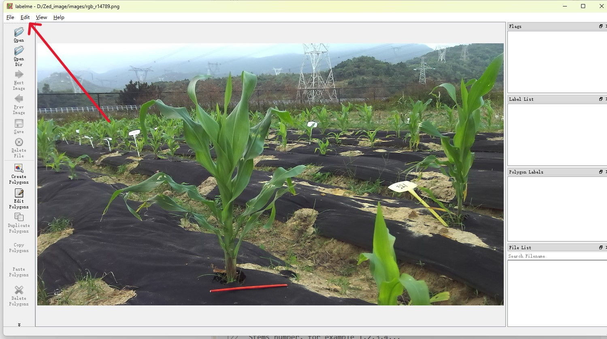

#### 2.3.3 Step 3 – Label
Stem labels use integer IDs, for example 1, 2, 3, 4, …

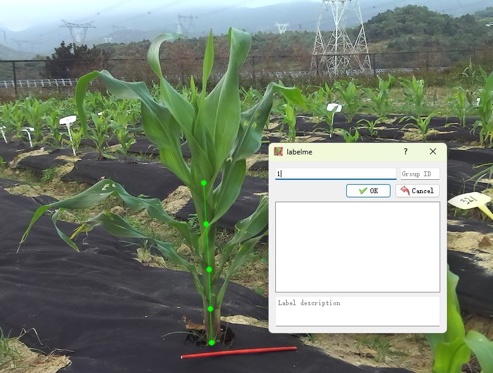

Leaf labels use the pattern `plantID-y`, for example 1-y, 2-y, 3-y, 4-y, …

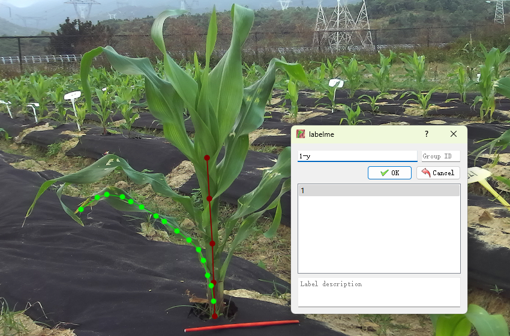

All leaves belonging to the first maize plant are labeled `1-y`, and so on for other plants.

#### 2.3.4 Step 4 – Save
Save the JSON file to the same folder as the image, using the same filename prefix.

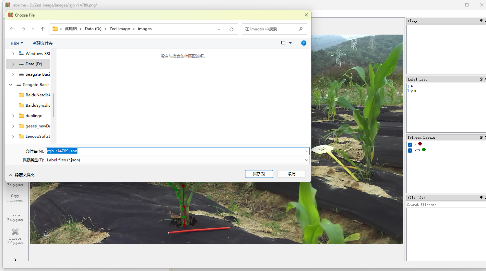

### 2.4 Conventional field measurements

#### 2.4.1 Leaf count

Each maize plant typically has 19–22 leaves, including visible and fully expanded leaves. We mainly count visible leaves, beginning at the 3–4 leaf stage after emergence. Counting starts from the first healthy visible leaf at the bottom and proceeds upward to the top visible leaf; this number is recorded as the total leaf count per plant.

#### 2.4.2 Plant height

Starting at the 3–4 leaf stage, plant height is measured every 3 days using a tower ruler (0.1 cm resolution) from the plant base to a predefined highest point. To improve accuracy, multiple observers measure each plant and the average is used as the final value.

#### 2.4.3 Physical coordinates of plants

Given plant height and 2D image coordinates, the relative camera position and elevation angle can be estimated to obtain camera pose calibration.

During sowing, plants are manually planted, and row spacing and within-row spacing are measured using a tape. The first plant at the edge of each plot is defined as position (0, 0). The physical coordinates of other plants are then derived from row and plant spacing in meters.

## 3 Phenotypic Database Architecture

### 3.1 Design and implementation

The maize phenotypic database consists of a frontend web application, a backend service, and a database.

- Backend: implemented with FastAPI (https://fastapi.tiangolo.com), handling HTTP requests from the frontend.
- Database: MongoDB (https://www.mongodb.com/) stores dataset metadata.
- Frontend: implemented with Vue 3 + TypeScript (https://vuejs.org/, https://typescriptlang.org/), using ByteDance Arco Design (https://github.com/arco-design/arco-design-pro-vue) as the UI component library. Data exchange between frontend and backend uses the Fetch API (https://developer.mozilla.org/zh-CN/docs/Web/API/Fetch_API).

### 3.2 Data management platform

The maize phenotypic database follows a standard browser/server (B/S) architecture and can be divided into three logical layers:

- Presentation layer (frontend/client): provides the user interface for browsing and querying data.
- Data logic layer (backend/server): implements core data processing and business logic.
- Data access layer (database server): handles data storage, retrieval, and query optimization.

<figure align=center>
    
</figure>


## 4 Dataset Presentation and Usage

### 4.1 Data visualization

The visualization module has two subcomponents: image display and annotation display. Images are grouped by acquisition time (e.g., quarterly), and users can click any image to view its annotations.

<figure align=center>
    
</figure>


### 4.2 Querying and using data

The database website is deployed on a Linux server and mainly consists of two pages: a dataset overview page and a dataset detail page. Data will be published at http://www.agis.maize.com/ (placeholder). Authorized users can log in to browse and download phenotypic data.

<figure align=center>
    
    
</figure>

### 4.3 Reading JSON annotations

#### 4.3.1 Read JSON files as keypoints

```python
from glob import glob
from itertools import groupby

import json
import os
import cv2
import codecs
import math


def getLineIndex(x0, y0, x1, y1):
    """Return all pixel coordinates along a line segment defined by two points."""
    steep = abs(y1 - y0) > abs(x1 - x0)
    if steep:
        x0, y0 = y0, x0
        x1, y1 = y1, x1
    switched = False
    if x0 > x1:
        switched = True
        x0, x1 = x1, x0
        y0, y1 = y1, y0
    ystep = 1 if y0 < y1 else -1
    deltax = x1 - x0
    deltay = abs(y1 - y0)
    error = -deltax / 2
    y = y0
    line = []
    for x in range(round(x0), round(x1 + 1)):
        if steep:
            line.append((round(y), round(x)))
        else:
            line.append((round(x), round(y)))

        error += deltay
        if error > 0:
            y += ystep
            error -= deltax
    if switched:
        line.reverse()
    return line


def getIndexList(json_path):
    index_list = []
    data = json.load(open(json_path, encoding="UTF-8"))
    for line in data["shapes"]:
        index_dict = {}
        point_list = []
        index_dict["label"] = line["label"]

        length = len(line["points"])
        for index, point in enumerate(line["points"]):
            if index < length - 1:
                temp_list = getLineIndex(
                    point[0],
                    point[1],
                    line["points"][index + 1][0],
                    line["points"][index + 1][1],
                )
                for p in temp_list:
                    point_list.append(p)
        index_dict["pointList"] = point_list
        index_list.append(index_dict)
    return index_list


def selectPoints(index_list):
    """Select 10 equally spaced keypoints along each polyline."""
    for i, line in enumerate(index_list):
        result_list = []
        all_points = line["pointList"]
        step = len(all_points) // 9
        for index in range(0, len(all_points), step):
            result_list.append(all_points[index])
        if len(result_list) == 10:
            if result_list[-1] != all_points[-1]:
                result_list[-1] = all_points[-1]
        else:
            result_list.append(all_points[-1])

        assert len(result_list) == 10, "Keypoint selection error!"
        index_list[i]["pointList"] = result_list
    return index_list


def getRecsAndKeyPoints(img_path, json_path):
    """Get bounding boxes and keypoints from a Labelme JSON file."""
    height, width, channels = cv2.imread(img_path).shape
    height = height * 2
    width = width * 2
    info = []
    data = json.load(open(json_path, encoding="UTF-8"))
    for line in data["shapes"]:

        line_points = []
        all_points = []
        length = len(line["points"])
        num_list = [
            "".join(list(g)) for k, g in groupby(line["label"], key=lambda x: x.isdigit())
        ]

        if num_list[0].isdigit():
            num_plant = int(num_list[0])
        elif len(num_list) > 1 and num_list[1].isdigit():
            num_plant = int(num_list[1])
        else:
            raise ValueError("wrong num")

        left_x, left_y, right_x, right_y = 0, 0, 0, 0
        for index, point in enumerate(line["points"]):
            line_points.append([round(point[0] / 4), round(point[1] / 4)])
            if index < length - 1:

                temp_list = getLineIndex(
                    point[0] / 4,
                    point[1] / 4,
                    line["points"][index + 1][0] / 4,
                    line["points"][index + 1][1] / 4,
                )
                for p in temp_list:
                    all_points.append(p)

            point = [item / 4 for item in point]
            if left_x == 0:
                left_x = point[0]
                right_x = point[0]
                left_y = point[1]
                right_y = point[1]
            else:
                if point[0] < left_x:
                    left_x = point[0]
                if point[0] > right_x:
                    right_x = point[0]
                if point[1] < left_y:
                    left_y = point[1]
                if point[1] > right_y:
                    right_y = point[1]

        step = len(all_points) // 9
        key_points = []
        if step == 0:
            for i in range(0, len(all_points)):
                key_points.append(all_points[i][0])
                key_points.append(all_points[i][1])
        else:
            for i in range(0, 9 * step, step):
                key_points.append(all_points[i][0])
                key_points.append(all_points[i][1])
        if len(key_points) == 20:
            if key_points[-1] != all_points[-1][1] or key_points[-2] != all_points[-1][0]:
                key_points[-1] = all_points[-1][1]
                key_points[-2] = all_points[-1][0]
        else:
            if len(key_points) == 18:
                key_points.append(all_points[-1][0])
                key_points.append(all_points[-1][1])
            else:
                for _ in range(0, 20 - len(key_points)):
                    key_points.append(0)
        if len(key_points) != 20:
            print("error")
        assert len(key_points) == 20, "Keypoint selection error!"
        info.append(
            {
                "label": ("leaf" if "y" in line["label"] else "root"),
                "bbox": [
                    math.floor(left_x) - 20 if math.floor(left_x) - 20 > 0 else 0,
                    math.floor(left_y) - 20 if math.floor(left_y) - 20 > 0 else 0,
                    math.ceil(right_x) + 20 if math.ceil(right_x) + 20 < width else width,
                    math.ceil(right_y) + 20 if math.ceil(right_y) + 20 < height else height,
                ],
                "keyPoints": key_points,
                "linePoints": line_points,
            }
        )

    # for num, plant in plants.items():
    #     left_x, left_y, right_x, right_y = 0, 0, 0, 0
    #     for point in plant:
    #         point = [item / 4 for item in point]
    #         if left_x == 0:
    #             left_x = point[0]
    #             right_x = point[0]
    #             left_y = point[1]
    #             right_y = point[1]
    #         else:
    #             if point[0] < left_x:
    #                 left_x = point[0]
    #             if point[0] > right_x:
    #                 right_x = point[0]
    #             if point[1] < left_y:
    #                 left_y = point[1]
    #             if point[1] > right_y:
    #                 right_y = point[1]
    #     info.append(
    #         {
    #             'label': 'plant',
    #             'bbox': [
    #                 math.floor(left_x) - 20 if math.floor(left_x) - 20 > 0 else 0,
    #                 math.floor(left_y) - 20 if math.floor(left_y) - 20 > 0 else 0,
    #                 math.ceil(right_x) + 20 if math.ceil(right_x) + 20 < width else width,
    #                 math.ceil(right_y) + 20 if math.ceil(right_y) + 20 < height else height
    #             ]
    #         })

    return info


def makeAnnotations(imgs_path, jsons_path, saved_path):

    if not os.path.exists(saved_path + "Annotations"):
        os.makedirs(saved_path + "Annotations")

    files = glob(jsons_path + "\\*.json")
    files = [i.replace("\\", "/").split("/")[-1].split(".json")[0] for i in files]

    # Read annotation information and write VOC-style XML
    for file_name in files:
        if os.path.exists(saved_path + "Annotations/" + file_name + ".xml"):
            continue
        jpg_path = os.path.join(imgs_path, file_name + ".JPG")
        json_path = os.path.join(jsons_path, file_name + ".json")
        if not os.path.exists(jpg_path):
            print("pass {}".format(os.path.basename(jpg_path)))
            continue
        print(os.path.basename(jpg_path))
        infos = getRecsAndKeyPoints(jpg_path, json_path)
        height, width, channels = cv2.imread(jpg_path).shape
        height = height * 2
        width = width * 2

        with codecs.open(saved_path + "Annotations/" + file_name + ".xml", "w", "utf-8") as xml:
            xml.write("<annotation>\n")
            xml.write("\t<folder>" + "cornDataset" + "</folder>\n")
            xml.write("\t<filename>" + file_name + ".jpg" + "</filename>\n")
            xml.write("\t<source>\n")
            xml.write("\t\t<database>cornDataset</database>\n")
            xml.write("\t\t<annotation>corn</annotation>\n")
            xml.write("\t\t<image>flickr</image>\n")
            xml.write("\t</source>\n")
            xml.write("\t<size>\n")
            xml.write("\t\t<width>" + str(width) + "</width>\n")
            xml.write("\t\t<height>" + str(height) + "</height>\n")
            xml.write("\t\t<depth>" + str(channels) + "</depth>\n")
            xml.write("\t</size>\n")
            xml.write("\t<segmented>0</segmented>\n")
            for index, info in enumerate(infos):
                name = info["label"]
                coordinate = info["bbox"]
                if "keyPoints" in info.keys():
                    assert "linePoints" in info.keys(), "key error"
                    key_points = info["keyPoints"]
                    line_points = info["linePoints"]
                else:
                    key_points = None
                    line_points = None
                xmin = coordinate[0]
                ymin = coordinate[1]
                xmax = coordinate[2]
                ymax = coordinate[3]
                if xmax <= xmin:
                    print("xmax={a}, xmin = {b}, skip this object".format(a=xmax, b=xmin))
                elif ymax <= ymin:
                    print("ymax={a}, ymin = {b}, skip this object".format(a=ymax, b=ymin))
                else:
                    xml.write("\t<object>\n")
                    xml.write("\t\t<name>" + name + "</name>\n")
                    xml.write("\t\t<pose>Unspecified</pose>\n")
                    if xmin <= 0 or xmax >= float(width) or ymin <= 0 or ymax >= float(height):
                        xml.write("\t\t<truncated>1</truncated>\n")
                    else:
                        xml.write("\t\t<truncated>0</truncated>\n")
                    xml.write("\t\t<difficult>0</difficult>\n")
                    xml.write("\t\t<bndbox>\n")
                    xml.write("\t\t\t<xmin>" + str(int(xmin)) + "</xmin>\n")
                    xml.write("\t\t\t<ymin>" + str(int(ymin)) + "</ymin>\n")
                    xml.write("\t\t\t<xmax>" + str(int(xmax)) + "</xmax>\n")
                    xml.write("\t\t\t<ymax>" + str(int(ymax)) + "</ymax>\n")
                    xml.write("\t\t</bndbox>\n")
                    if key_points is not None and line_points is not None:
                        xml.write("\t\t<keypoints>" + str(key_points) + "</keypoints>\n")
                        xml.write("\t\t<linepoints>" + str(line_points) + "</linepoints>\n")
                    xml.write("\t</object>\n")
            xml.write("</annotation>")


makeAnnotations(imgs_path="xxx", jsons_path="xxx", saved_path="xxx")
```

#### 4.3.2 Read JSON files as rectangles

```python
import codecs
import json
import math
import os
from glob import glob


def getRectangles(json_path, offset):

    info = []
    data = json.load(open(json_path, encoding="UTF-8"))
    width = data["imageWidth"]
    height = data["imageHeight"]
    for line in data["shapes"]:

        left_x, left_y, right_x, right_y = 0, 0, 0, 0

        for index, point in enumerate(line["points"]):

            point = [item / 4 for item in point]
            if left_x == 0:
                left_x = point[0]
                right_x = point[0]
                left_y = point[1]
                right_y = point[1]
            else:
                if point[0] < left_x:
                    left_x = point[0]
                if point[0] > right_x:
                    right_x = point[0]
                if point[1] < left_y:
                    left_y = point[1]
                if point[1] > right_y:
                    right_y = point[1]
        info.append(
            {
                "label": ("leaf" if "y" in line["label"] else "root"),
                "bbox": [
                    math.floor(left_x) - offset if math.floor(left_x) - offset > 0 else 0,
                    math.floor(left_y) - offset if math.floor(left_y) - offset > 0 else 0,
                    math.ceil(right_x) + offset if math.ceil(right_x) + offset < width else width,
                    math.ceil(right_y) + offset if math.ceil(right_y) + offset < height else height,
                ],
            }
        )
    return info


def readJsons(jsons_path, xmls_save_path):

    """Read Labelme JSON files in bulk and convert them to XML files."""

    files = glob(jsons_path + "\\*.json")
    files = [i.replace("\\", "/").split("/")[-1].split(".json")[0] for i in files]

    for file_name in files:

        json_path = os.path.join(jsons_path, file_name + ".json")
        infos = getRectangles(json_path, offset=20)
        with codecs.open(xmls_save_path + "Annotations/" + file_name + ".xml", "w", "utf-8") as xml:
            xml.write("<annotation>\n")
            xml.write("\t<folder>" + "cornDataset" + "</folder>\n")
            xml.write("\t<filename>" + file_name + ".jpg" + "</filename>\n")
            xml.write("\t<source>\n")
            xml.write("\t\t<database>cornDataset</database>\n")
            xml.write("\t\t<annotation>corn</annotation>\n")
            xml.write("\t\t<image>flickr</image>\n")
            xml.write("\t</source>\n")
            xml.write("\t<segmented>0</segmented>\n")
            for index, info in enumerate(infos):
                name = info["label"]
                rectangle = info["bbox"]

                xmin = rectangle[0]
                ymin = rectangle[1]
                xmax = rectangle[2]
                ymax = rectangle[3]

                if xmax <= xmin:
                    print("xmax={a}, xmin = {b}, skip this object".format(a=xmax, b=xmin))
                elif ymax <= ymin:
                    print("ymax={a}, ymin = {b}, skip this object".format(a=ymax, b=ymin))
                else:
                    xml.write("\t<object>\n")
                    xml.write("\t\t<name>" + name + "</name>\n")
                    xml.write("\t\t<pose>Unspecified</pose>\n")
                    xml.write("\t\t<difficult>0</difficult>\n")
                    xml.write("\t\t<bndbox>\n")
                    xml.write("\t\t\t<xmin>" + str(int(xmin)) + "</xmin>\n")
                    xml.write("\t\t\t<ymin>" + str(int(ymin)) + "</ymin>\n")
                    xml.write("\t\t\t<xmax>" + str(int(xmax)) + "</xmax>\n")
                    xml.write("\t\t\t<ymax>" + str(int(ymax)) + "</ymax>\n")
                    xml.write("\t\t</bndbox>\n")
            xml.write("</annotation>")


readJsons(jsons_path="xxx", xmls_save_path="xxx")
```

#### 4.3.3 Other utility scripts

Import Python packages and helper functions:

```python
from PIL import Image, ImageColor, ImageOps
from xml.dom.minidom import parse
from sklearn.model_selection import train_test_split
from glob import glob
import cv2
import base64
import json
import os


def checkLabel(jpg_path, xml_path):

    STANDARD_COLORS = [
        "black",
        "DarkOrange",
        "IndianRed",
        "FireBrick",
        "HotPink",
        "Gold",
        "AliceBlue",
        "Salmon",
        "Chartreuse",
        "Aqua",
        "Aquamarine",
        "Azure",
        "Beige",
        "Bisque",
        "BlanchedAlmond",
        "BlueViolet",
        "BurlyWood",
        "CadetBlue",
        "AntiqueWhite",
        "Chocolate",
        "Coral",
        "CornflowerBlue",
        "Cornsilk",
        "Crimson",
        "Cyan",
        "DarkCyan",
        "DarkGoldenRod",
        "DarkGrey",
        "DarkKhaki",
        "DarkOrchid",
        "DarkSalmon",
        "DarkTurquoise",
        "DarkViolet",
        "DeepPink",
        "DeepSkyBlue",
        "DodgerBlue",
        "FloralWhite",
        "Fuchsia",
        "Gainsboro",
        "GhostWhite",
        "GoldenRod",
        "Tan",
        "HoneyDew",
        "HotPink",
        "Ivory",
        "Khaki",
        "Lavender",
        "LavenderBlush",
        "LemonChiffon",
        "LightBlue",
        "LightCoral",
        "LightCyan",
        "LightGoldenRodYellow",
        "LightGray",
        "LightGrey",
        "LightPink",
        "LightSalmon",
        "LightSkyBlue",
        "LightSlateGray",
        "LightSlateGrey",
        "LightSteelBlue",
        "LightYellow",
        "Linen",
        "Magenta",
        "MediumAquaMarine",
        "MediumOrchid",
        "MediumPurple",
        "MediumSlateBlue",
        "MediumTurquoise",
        "MediumVioletRed",
        "MintCream",
        "MistyRose",
        "Moccasin",
        "NavajoWhite",
        "OldLace",
        "Olive",
        "OliveDrab",
        "Orange",
        "OrangeRed",
        "Orchid",
        "PaleGoldenRod",
        "PaleTurquoise",
        "PaleVioletRed",
        "PapayaWhip",
        "PeachPuff",
        "Peru",
        "Pink",
        "Plum",
        "PowderBlue",
        "Purple",
        "Red",
        "RosyBrown",
        "RoyalBlue",
        "SaddleBrown",
        "SandyBrown",
        "SeaShell",
        "Sienna",
        "Silver",
        "SkyBlue",
        "SlateBlue",
        "SlateGray",
        "SlateGrey",
        "Snow",
        "SteelBlue",
        "Teal",
        "Thistle",
        "Tomato",
        "Turquoise",
        "Violet",
        "Wheat",
        "White",
        "WhiteSmoke",
        "Yellow",
    ]

    dom = parse(xml_path)
    objects = dom.getElementsByTagName("object")
    colors = [
        ImageColor.getrgb(STANDARD_COLORS[i % len(STANDARD_COLORS)])
        for i in range(0, len(objects))
    ]
    img = cv2.imread(jpg_path)

    for index, obj in enumerate(objects):
        xmin = obj.getElementsByTagName("xmin")[0].childNodes[0].data
        ymin = obj.getElementsByTagName("ymin")[0].childNodes[0].data
        xmax = obj.getElementsByTagName("xmax")[0].childNodes[0].data
        ymax = obj.getElementsByTagName("ymax")[0].childNodes[0].data
        cv2.rectangle(
            img,
            (int(xmin), int(ymin)),
            (int(xmax), int(ymax)),
            colors[index],
            1,
        )
    cv2.imwrite("result.jpg", img)


def getObjectNums():
    """Count the number of objects per JSON file."""

    total_files = glob(r"G:\\jsons\\*.json")
    for json_file in total_files:
        data = json.load(open(json_file, encoding="UTF-8"))
        if len(data["shapes"]) >= 255:
            print(json_file)
            print(len(data["shapes"]))


def splitTrainAndVal(isUseTest, saved_path):
    """Split the dataset into train/val/(optional) test sets."""

    txtsavepath = saved_path + "/ImageSets/Main/"
    ftrainval = open(txtsavepath + "/trainval.txt", "w")
    ftest = open(txtsavepath + "/test.txt", "w")
    ftrain = open(txtsavepath + "/train.txt", "w")
    fval = open(txtsavepath + "/val.txt", "w")
    total_files = glob(saved_path + "/Annotations/" + "*.xml")
    total_files = [
        i.replace("\\", "/").split("/")[-1].split(".xml")[0] for i in total_files
    ]
    trainval_files = []
    test_files = []
    if isUseTest:
        trainval_files, test_files = train_test_split(
            total_files, test_size=0.002, random_state=55
        )
    else:
        trainval_files = total_files
    for file in trainval_files:
        ftrainval.write(file + "\n")
    train_files, val_files = train_test_split(
        trainval_files, test_size=0.10, random_state=55
    )
    # train
    for file in train_files:
        ftrain.write(file + "\n")
    # val
    for file in val_files:
        fval.write(file + "\n")
    for file in test_files:
        print(file)
        ftest.write(file + "\n")
    ftrainval.close()
    ftrain.close()
    fval.close()
    ftest.close()


def jsonToJpg(jsons_path, save_path, resize_ratio=None):
    """Generate JPG images from json['imageData']."""

    total_files = os.listdir(jsons_path)
    print(len(total_files))

    for index, json_file in enumerate(total_files):
        print(index + 1)
        json_path = os.path.join(jsons_path, json_file)

        image_data = json.load(open(json_path, encoding="UTF-8"))["imageData"]
        image_data = base64.b64decode(image_data)  # decode

        jpg_path = os.path.join(save_path, json_file.split(".")[0] + ".JPG")
        file = open(jpg_path, "wb")
        file.write(image_data)
        file.close()
        if resize_ratio is not None:

            image = Image.open(
                os.path.join(save_path, json_file.split(".")[0] + ".JPG")
            )
            image = ImageOps.exif_transpose(image)
            image = image.resize(
                (
                    int(image.size[0] / resize_ratio),
                    int(image.size[1] / resize_ratio),
                )
            )
            image.save(
                os.path.join(save_path, json_file.split(".")[0] + ".JPG")
            )
```

## 5 Acknowledgements

We thank all users who view and use this dataset. Your feedback and use cases motivate us to continue data collection and to improve this resource. We also encourage you to develop new algorithms and pipelines based on this dataset, including traditional image-processing methods and deep learning models.

If you have any questions or suggestions, please feel free to contact us:

E-mail: jianyechang6511@163.com