[TOC]
# MIPDB: A High-Quality Keypoint Annotation Dataset and Benchmark for Maize in Complex Field Scenes

This document provides the data and annotation instructions for the paper **"MIPDB: A High-Quality Keypoint Annotation Dataset and Benchmark for Maize in Complex Field Scenes"**. MIPDB stands for the **Maize Image Phenotyping Database**. It describes how images were collected, how maize stems and leaves were annotated with keypoints and bounding boxes, how the phenotypic database is organized, and how to use the provided Python scripts to convert and visualize annotations for downstream benchmarking and model development.

**[NEW—REVISION] Authors:** Jianye Chang, Panpan Wang, Wenpeng Deng, Mengtao Wang, Feng Qin, Zhihao Hou, Jason John Walsh, Eleni Mangina, Sonia Negrão, Yun Zhou, Ting Yang, Zhen Zhang, Hailin Liu, and Jue Ruan. Chang, Wang, and Deng contributed equally. Corresponding authors: Zhen Zhang, Hailin Liu, and Jue Ruan.

**[NEW—REVISION] Dataset overview:** MIPDB contains 35,739 field-acquired RGB images collected from 2021 to 2024. Of these, 28,532 were acquired using handheld DSLR cameras and 7,207 using UAVs. Structured point-line annotations are available for 17,697 images, including 14,855 DSLR images and 2,842 UAV images.

> **[NEW—REVISION] Scope of the annotation protocol.** The original annotation campaign used visual judgment to select foreground plants; it did not record fixed pixel-size, camera-distance, or occlusion thresholds. The protocol below documents the operational decisions that should be used for reproducible re-annotation and future dataset extensions. It should not be interpreted as a retrospective claim that these quantitative rules were applied to every image in the original release.

## Maize Image Phenotyping Database User Guide

**[NEW—REVISION] Dataset scope:** MIPDB is primarily a structural point-line and keypoint dataset for maize pose estimation and phenotypic analysis. Bounding boxes derived from point-line annotations and the separate segmentation experiment are auxiliary resources, not independent exhaustive annotations of every plant visible in every image.

## 1 Labelme Overview

Labelme is an image annotation tool used to create datasets for training neural networks. It runs on Python and is typically installed inside an Anaconda environment, which can be downloaded from https://www.anaconda.com/products/distribution.


### 1.1 Requirements

- Windows
- Python3
- [PyQt5](http://www.riverbankcomputing.co.uk/software/pyqt/intro)
- pillow

### 1.2 Installation

#### 1.2.1 Create a virtual environment

Before installing Labelme, create an Anaconda virtual environment. Open Anaconda Prompt and run:

```cmd
conda create -n labelme python=3.8
# This creates a virtual environment named "labelme" with Python 3.8
```
<div align=center>

</div>

#### 1.2.2 View available virtual environments

List all virtual environments with:

```cmd
conda env list
```
<div align=center>
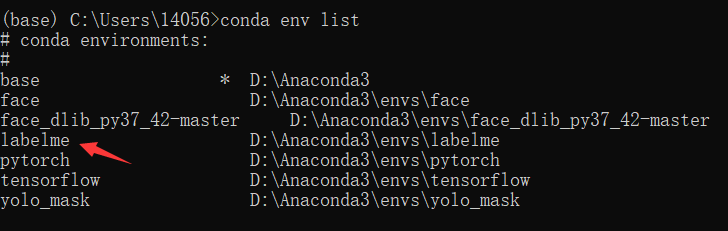
</div>


#### 1.2.3 Activate the virtual environment and install dependencies

Activate the environment:

```cmd
conda activate labelme
```
<div align=center>
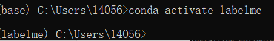
</div>

```cmd
pip install pyqt5

or

#pip install pyqt5 -i http://pypi.douban.com/simple/ --trusted-host pypi.douban.com 

pip install pillow

or

#pip install pillow -i http://pypi.douban.com/simple/ --trusted-host pypi.douban.com
```

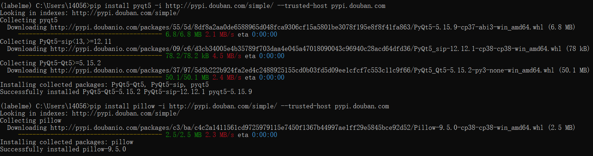

#### 1.2.4 Install Labelme

Install Labelme (version 5.3.0a0 as an example):

```cmd
pip install labelme==5.3.0a0

# Alternatively, using a Chinese mirror:
# pip install labelme==5.3.0a0 -i http://mirrors.aliyun.com/pypi/simple/ --trusted-host mirrors.aliyun.com
```

After installation, start Labelme with:

```cmd
labelme
```

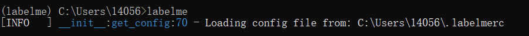

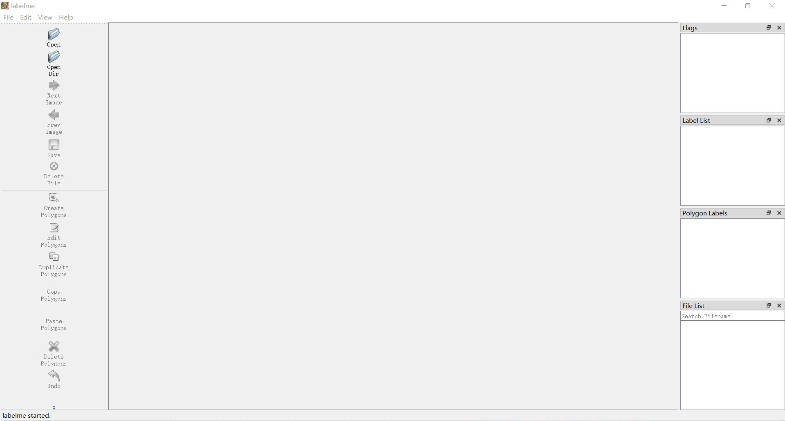

#### 1.2.5 Open labelme

For later use, open Anaconda Prompt, activate the Labelme environment, and launch Labelme:

```cmd
conda activate labelme
labelme
```

## 2 How do we collect data?

### 2.1 Image acquisition devices

This dataset uses two RGB imaging setups: a handheld DSLR camera and a camera mounted on a small drone. The drone is used to capture large-scale canopy images from above, while the handheld camera is used for near-field side views of individual plants.

#### 2.1.1 Handheld DSLR camera

The handheld camera is used to collect small-area side-view images of maize plants. The shooting frequency and angle are adjusted according to growth stage. For each plot, four plants (top, bottom, left, right) are used, and images are captured from four angles (0°, 90°, 180°, 270°), one photo per angle.

<figure align=center>
    
    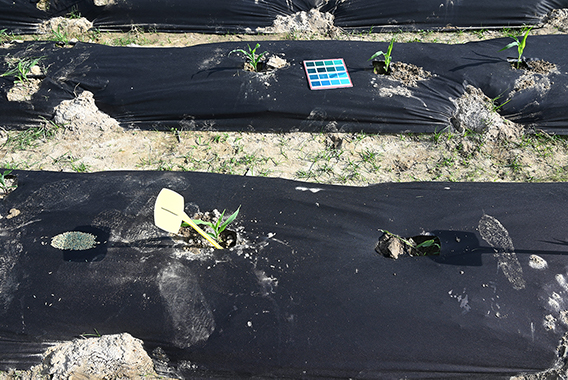
    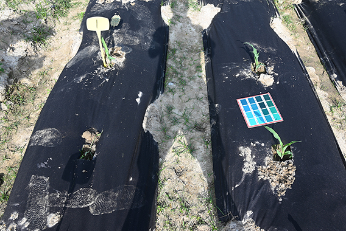
    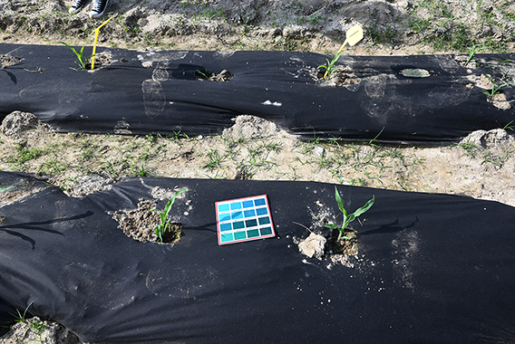
</figure>

#### 2.1.2 Small drone

Drone acquisitions are synchronized in time and frequency with the handheld camera. Two flight configurations are used: one with <10% image overlap for annotation and deep-learning datasets, and one with >60% overlap for image mosaicking. The drone camera is kept at a 90° nadir angle.

<figure align=center>
    
    
</figure>

### 2.2 Plant ID calibration and leaf labeling

#### 2.2.1 Maize plant ID calibration

Plants in each image are organized into a 2×2 grid based on the orientation of a numbered plate in the lower-left corner. This angle is mapped to the physical positions of plants, and the remaining three viewing angles are defined by 90°, 180°, and 270° rotations.

By annotating only the numbered plates at each angle, we can automatically infer IDs for plants without visible plates. After verifying all IDs, a plant-ID file is exported.

<figure align=center>
    
    
</figure>

#### 2.2.2 Corn leaf labeling

Labelme is used to annotate both stems and leaves. To balance efficiency and information content, we annotate leaf veins and stems using line segments.


**[NEW—REVISION] Annotation representation:** The original Labelme lines are manually clicked point-line annotations. For model-format conversion, these points may be densified or resampled into a fixed number of points. Manually clicked points and generated points must therefore be distinguished; generated points are not additional independent manual observations. The plant ID in a leaf label, such as `1-y`, identifies the parent plant instance.

#### 2.2.3 **[NEW—REVISION]** Foreground-plant inclusion and exclusion protocol

**[NEW—REVISION]** The annotation unit is an individually identifiable maize plant in the image. Inclusion is based on whether the plant can be attributed to one plant instance and whether at least one stem segment or leaf midrib can be followed reliably in the visible image. The protocol does not use camera distance as a direct criterion, because the same physical plant can occupy different numbers of pixels in DSLR and UAV images. Instead, visibility and instance identifiability are assessed in image coordinates.

**[NEW—REVISION]** For reproducible annotation, apply the following decision rules:

| **[NEW] Image condition** | **[NEW] Annotation rule** |
|---|---|
| An individual plant is identifiable and at least one stem or leaf midrib is visibly traceable | Include the plant and annotate all traceable visible organs. |
| A plant is visible only as an unidentifiable fragment, or cannot be assigned to one plant instance | Exclude it from instance-level keypoint annotation. |
| A background plant is identifiable but is outside the foreground acquisition unit | Exclude it unless the image is designated for exhaustive-scene annotation. Record this as an exclusion rather than treating it as a confirmed negative plant. |
| A plant is partially occluded by another plant or field object, but the visible organ can still be attributed to it | Include the visible stem or midrib segment and preserve the plant ID. Do not draw through the occluder. |
| Two plants overlap and their stems or midribs cannot be assigned unambiguously | Annotate only the unambiguous portions; do not merge the two plants into one instance. If no unambiguous portion remains, exclude the fragment. |
| A leaf tip is visible | Trace the midrib to the visible tip. |
| A leaf tip is hidden, truncated by the image boundary, or not reliably discernible | Stop at the last visually supported point and do not infer the hidden continuation. |
| The plant is too small or blurred for reliable instance attribution | Exclude it and record the reason as `unidentifiable` or `insufficient_visible_structure`, rather than using an arbitrary pixel threshold. |

**[NEW—REVISION]** For a future quantitative re-annotation audit, each image should additionally record: the foreground acquisition unit, plant instance ID, visibility status, occlusion status, image-boundary truncation, and exclusion reason. A fixed minimum visible-length or pixel-size threshold should be selected from an audited pilot subset before it is applied to the full dataset; it must not be introduced retrospectively without measuring its effect on different growth stages and both imaging modalities.

**[NEW—REVISION]** The released point-line annotations are positive instance annotations, not exhaustive masks of every plant visible in every image. Consequently, an unannotated background plant must not automatically be interpreted as a true negative in detection or recall calculations. Exhaustive-scene detection evaluation requires either complete annotation of all eligible plants or an exclusion/ignore mask for unannotated regions.


### 2.3 How we label images

> **[NEW—REVISION]** The following steps describe the Labelme operation after the foreground-plant decision has been made. Labelme is the annotation tool; it does not determine which plants should be included.

#### 2.3.1 Step 1 – Open the image
Open the image in Labelme.

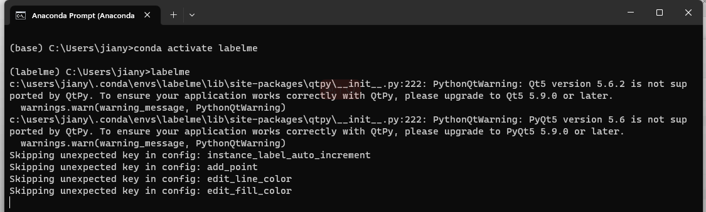

#### 2.3.2 Step 2 – Choose Create LineStrip
From the menu, select Edit → Create LineStrip.

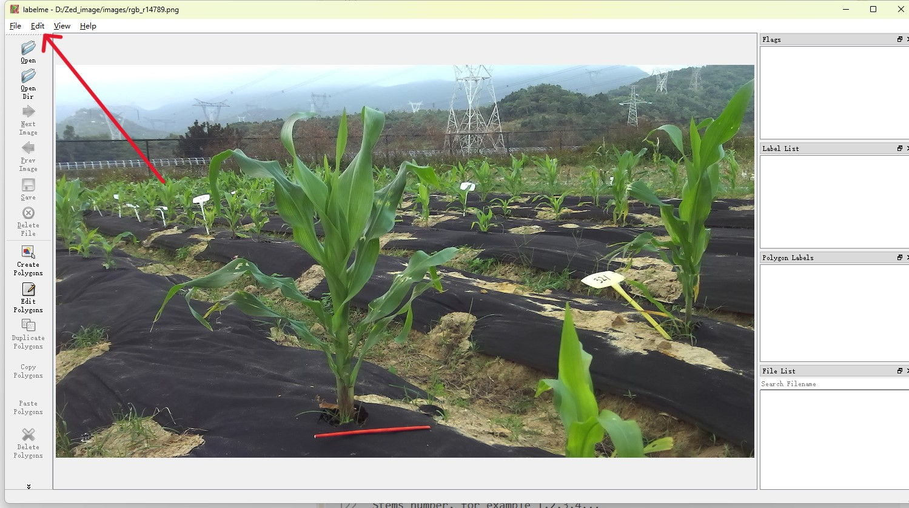

#### 2.3.3 Step 3 – Label
Stem labels use integer IDs, for example 1, 2, 3, 4, …

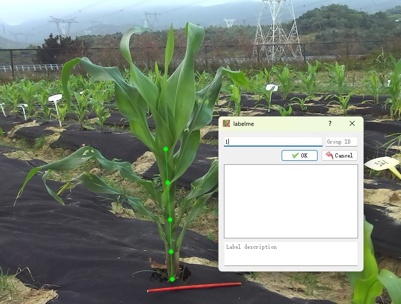

Leaf labels use the pattern `plantID-y`, for example `1-y`, `2-y`, `3-y`, `4-y`, …

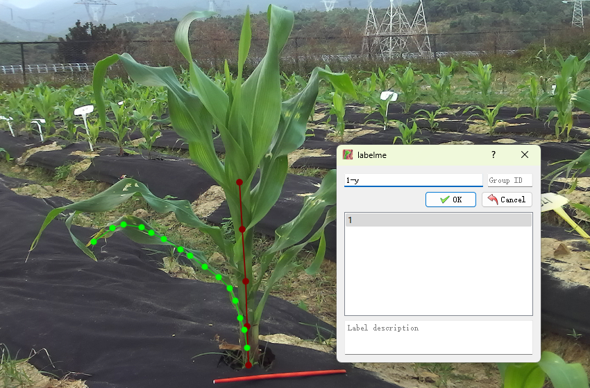

All leaves belonging to the first maize plant are labeled `1-y`, and so on for other plants. **[NEW—REVISION]** The shared plant ID links each leaf line to its parent plant; it does not imply that the hidden part of an occluded leaf has been reconstructed.

#### 2.3.4 Step 4 – Save
Save the JSON file to the same folder as the image, using the same filename prefix.

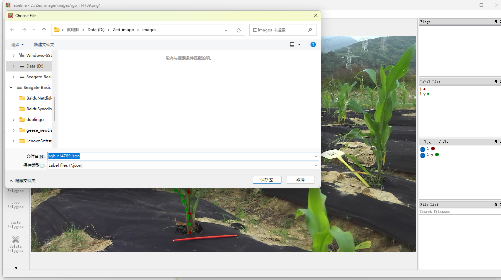

### 2.4 Conventional field measurements

#### 2.4.1 Leaf count

Each maize plant typically has 19–22 leaves, including visible and fully expanded leaves. We mainly count visible leaves, beginning at the 3–4 leaf stage after emergence. Counting starts from the first healthy visible leaf at the bottom and proceeds upward to the top visible leaf; this number is recorded as the total leaf count per plant.

#### 2.4.2 Plant height

Starting at the 3–4 leaf stage, plant height is measured every 3 days using a tower ruler (0.1 cm resolution) from the plant base to a predefined highest point. To improve accuracy, multiple observers measure each plant and the average is used as the final value.

#### 2.4.3 Physical coordinates of plants

Given plant height and 2D image coordinates, the relative camera position and elevation angle can be estimated to obtain camera pose calibration.

During sowing, plants are manually planted, and row spacing and within-row spacing are measured using a tape. The first plant at the edge of each plot is defined as position (0, 0). The physical coordinates of other plants are then derived from row and plant spacing in meters.

## 3 Phenotypic Database Architecture

### 3.1 Design and implementation

The maize phenotypic database consists of a frontend web application, a backend service, and a database.

- Backend: implemented with FastAPI (https://fastapi.tiangolo.com), handling HTTP requests from the frontend.
- Database: MongoDB (https://www.mongodb.com/) stores dataset metadata.
- Frontend: implemented with Vue 3 + TypeScript (https://vuejs.org/, https://typescriptlang.org/), using ByteDance Arco Design (https://github.com/arco-design/arco-design-pro-vue) as the UI component library. Data exchange between frontend and backend uses the Fetch API (https://developer.mozilla.org/zh-CN/docs/Web/API/Fetch_API).

### 3.2 Data management platform

The maize phenotypic database follows a standard browser/server (B/S) architecture and can be divided into three logical layers:

- Presentation layer (frontend/client): provides the user interface for browsing and querying data.
- Data logic layer (backend/server): implements core data processing and business logic.
- Data access layer (database server): handles data storage, retrieval, and query optimization.

<figure align=center>
    
</figure>


## 4 Dataset Presentation and Usage

### 4.1 Website and access

**[NEW—REVISION]** MIPDB is publicly accessible at [http://phenomics.agis.org.cn](http://phenomics.agis.org.cn). The website provides dataset browsing, annotation visualization, and batch access to images and annotation files. Users should consult the website for the current access and download procedure.

### 4.2 Data visualization

The visualization module has two subcomponents: image display and annotation display. Images are grouped by acquisition time (e.g., quarterly), and users can click any image to view its annotations.

<figure align=center>
    
</figure>


## 5 Acknowledgements

We thank all users who view and use this dataset. Your feedback and use cases motivate us to continue data collection and to improve this resource. We also encourage you to develop new algorithms and pipelines based on this dataset, including traditional image-processing methods and deep learning models.

If you have any questions or suggestions, please feel free to contact us:

E-mail: jianyechang6511@163.com