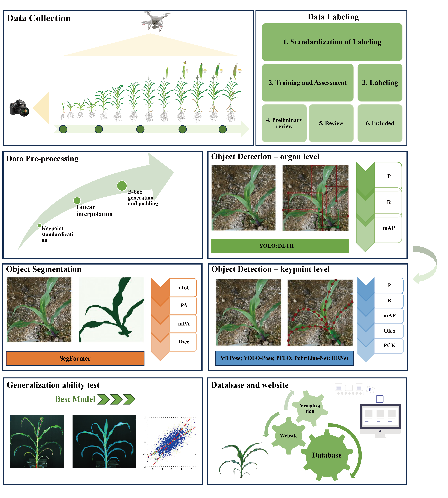
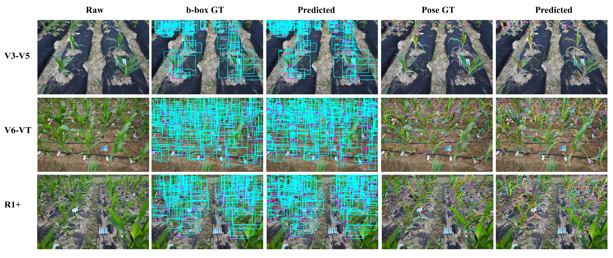
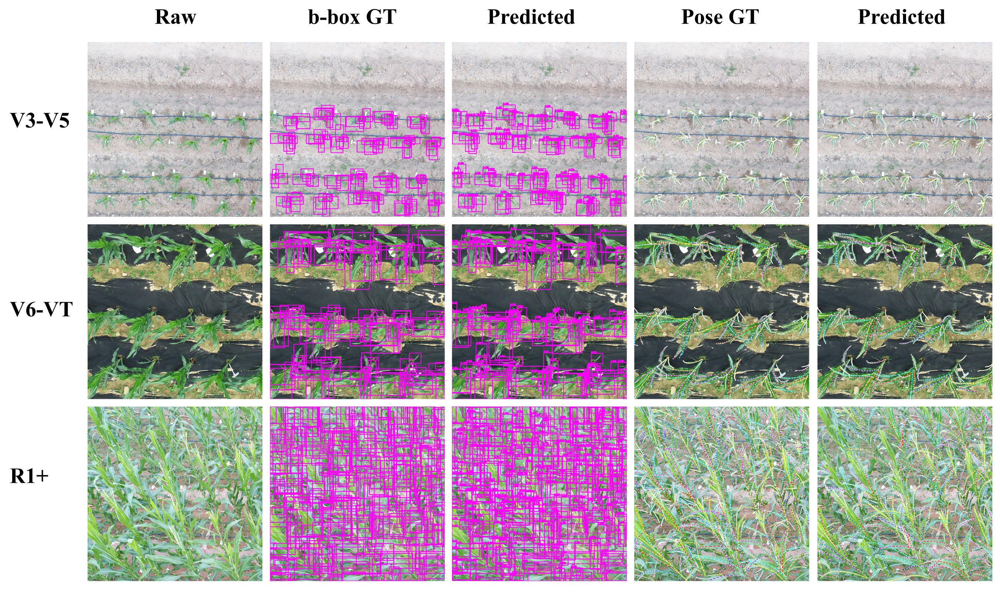

# MIPDB Toolkit

Tools, model weights, and documentation for **MIPDB: A High-Quality Keypoint
Annotation Dataset and Benchmark for Maize in Complex Field Scenes**.

This repository is being released openly to make the available MIPDB
resources easier to use and reproduce. The public release is staged: **the
current release contains object-detection model weights, data-processing
tools, and links to the keypoint-detection and semantic-segmentation model
weights**. The larger keypoint-detection and semantic-segmentation checkpoints
are hosted on Google Drive.

<p align="center">
  
</p>

## Paper

> **MIPDB: A High-Quality Keypoint Annotation Dataset and Benchmark for Maize
> in Complex Field Scenes**
>
> Jianye Chang, Panpan Wang, Wenpeng Deng, Mengtao Wang, Feng Qin, Zhihao
> Hou, Jason John Walsh, Eleni Mangina, Sonia Negrão, Yun Zhou, Ting Yang,
> Zhen Zhang, Hailin Liu, Jue Ruan

## Dataset and annotation scope

MIPDB (Maize Image Phenotyping Database) contains **35,739** field-acquired
RGB images collected from 2021 to 2024. Of these, **28,532** were acquired
with handheld DSLR cameras and **7,207** with UAVs. Structured point-line
annotations are available for **17,697** images, including 14,855 DSLR images
and 2,842 UAV images.

MIPDB is primarily a structural point-line and keypoint dataset for maize pose
estimation and phenotypic analysis. Bounding boxes derived from point-line
annotations and the separate segmentation experiment are auxiliary resources,
not exhaustive annotations of every plant visible in every image.

### Foreground-plant annotation rules

The foreground acquisition unit contains, at a minimum, the four plants in the
2×2 grid, together with other clearly structured plants situated approximately
on the same horizontal plane. A plant is included when it can be assigned to
one individual instance and at least one stem segment and one leaf midrib can
be followed reliably.

- Unidentifiable fragments, plants outside the designated foreground area, and
  plants too small or blurry for reliable attribution are excluded.
- For overlap or partial occlusion, preserve the plant ID and annotate only
  portions that can be assigned to that plant.
- If a leaf tip or its continuation is visible beyond an occluder and the
  anatomical continuity is clear, the hidden interval may be connected.
  Otherwise, stop at the last point supported by visual evidence.
- The released point-line annotations are positive instance annotations, not
  exhaustive scene labels. An unannotated background plant must not
  automatically be treated as a true negative.

The original campaign used visual judgment and did not retain fixed pixel-size,
camera-distance, or occlusion thresholds, exclusion masks, or
inter-annotator-agreement records. The 5% image recheck and 15% bounding-box
inspection were routine error checks rather than a formal completeness
validation. Recall calculated on the annotated subset should therefore be
described as **annotated-set recall**, not absolute scene recall.

For the complete annotation protocol, Labelme instructions, quality-control
clarification, and reproducible re-annotation guidance, see
[`MIPDB_Markdown/mpdb_markdown.md`](./MIPDB_Markdown/mpdb_markdown.md).

## Visual examples

The following examples show the types of DSLR and UAV imagery included in
the benchmark and representative detection results. They are provided for
context; the currently released model weights are listed in
[Available models](#available-models).

<p align="center">
  
  
</p>

## Repository contents

| Path | Description |
| --- | --- |
| [`Model/`](./Model) | Pre-trained object-detection weights for DSLR and UAV imagery |
| [`Script/Dataset_Preprocess/`](./Script/Dataset_Preprocess) | Task-specific Labelme conversion tools; see its README before choosing a branch |
| [`Script/labelme2coco_withocclusion/`](./Script/labelme2coco_withocclusion) | Labelme-to-COCO conversion tools with occlusion support |
| [`Script/UAV_Tile/`](./Script/UAV_Tile) | Utilities for tiling UAV orthophotos |
| [`Script/Viz/`](./Script/Viz) | Dataset statistics and visualization utilities |
| [`MIPDB_Markdown/`](./MIPDB_Markdown) | Detailed annotation protocol and Labelme guide |
| [`Reference/`](./Reference) | Reference papers related to the project |

## Available models

The [`Model/`](./Model) directory currently contains object-detection
checkpoints only:

- **DSLR images:** `dslr_detect_*`
- **UAV images:** `uav_detect_*`
- **UAV split setting:** `uav_split_detect_*`
- **Merged maize detection:** `merge_maize_detect_*`

The available checkpoint variants include the model families indicated by
their filenames, such as `v5`, `v8`, `v11`, `v26`, and `rt-detr`. The `.pt`
files are intended for inference and further experimentation. Check the
corresponding model or training configuration before comparing results across
variants.

### Additional model weights

The keypoint-detection and semantic-segmentation model weights are too large
to store directly in this repository. They are available from the following
Google Drive folder:

[Download keypoint-detection and semantic-segmentation models](https://drive.google.com/drive/folders/1RPDjMjt47Cw3LyaTaCrfR07dYIL7zn2U?usp=drive_link)

## Data processing

The provided scripts support common preparation steps for MIPDB annotations,
including:

- converting Labelme annotations to YOLO-format labels;
- converting annotations to COCO format;
- handling leaf, stem, and occlusion labels;
- splitting and resizing datasets;
- tiling UAV orthophotos; and
- inspecting dataset statistics.

For the annotation workflow and label definitions, see
[`MIPDB_Markdown/mpdb_markdown.md`](./MIPDB_Markdown/mpdb_markdown.md).
For the preprocessing branch selection and output-format differences, see
[`Script/Dataset_Preprocess/README.md`](./Script/Dataset_Preprocess/README.md).
Some conversion utilities have their own dependencies; see
[`Script/labelme2coco_withocclusion/requirements.txt`](./Script/labelme2coco_withocclusion/requirements.txt)
before running them.

## Current release scope

| Resource | Status |
| --- | --- |
| Object-detection weights | Available in [`Model/`](./Model) |
| Dataset-preprocessing scripts | Available |
| Annotation and data-processing documentation | Available |
| Keypoint-detection weights | Available via [Google Drive](https://drive.google.com/drive/folders/1RPDjMjt47Cw3LyaTaCrfR07dYIL7zn2U?usp=drive_link) |
| Semantic-segmentation weights | Available via [Google Drive](https://drive.google.com/drive/folders/1RPDjMjt47Cw3LyaTaCrfR07dYIL7zn2U?usp=drive_link) |

Please treat this table as the source of truth for what is currently
available in the open repository.

## Website

[MIPDB website - http://phenomics.agis.org.cn](http://phenomics.agis.org.cn)

## Citation

If you use MIPDB or this toolkit in your research, please cite the MIPDB
paper:

```text
Will come.
```

## Disclaimer

This repository is an ongoing public release. Model weights, scripts, and
documentation may be updated as additional components are prepared. If you
have any questions, please feel free to email me at
jianye.chang@ucdconnect.ie.